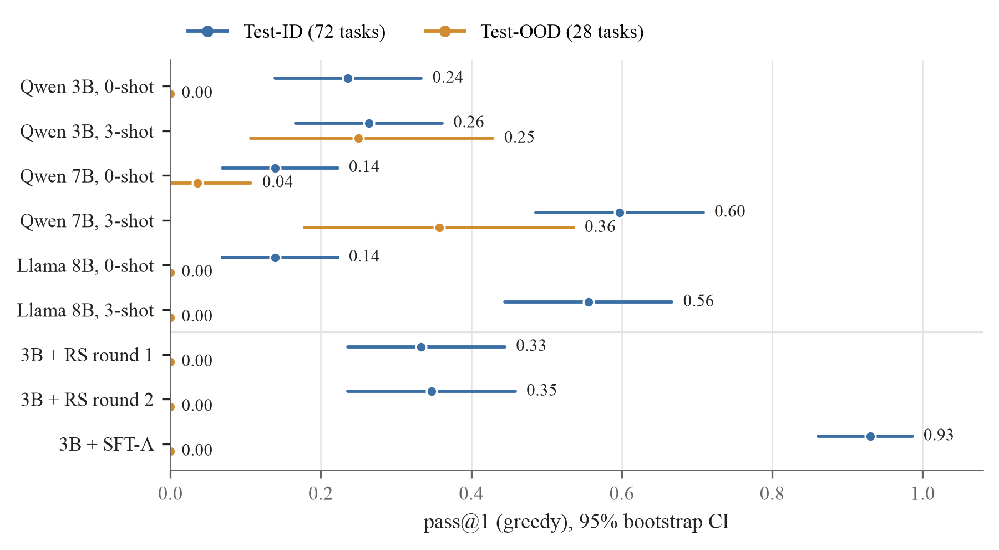
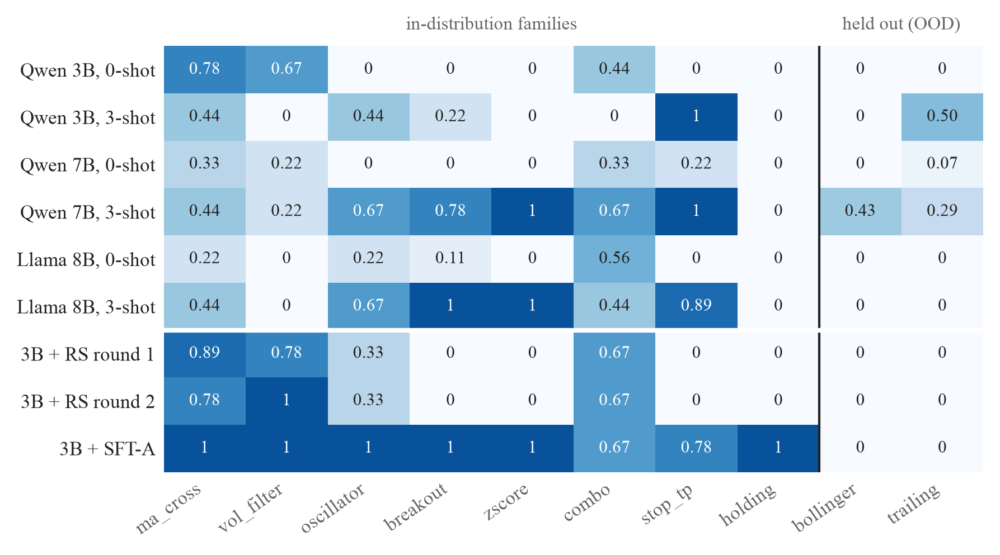
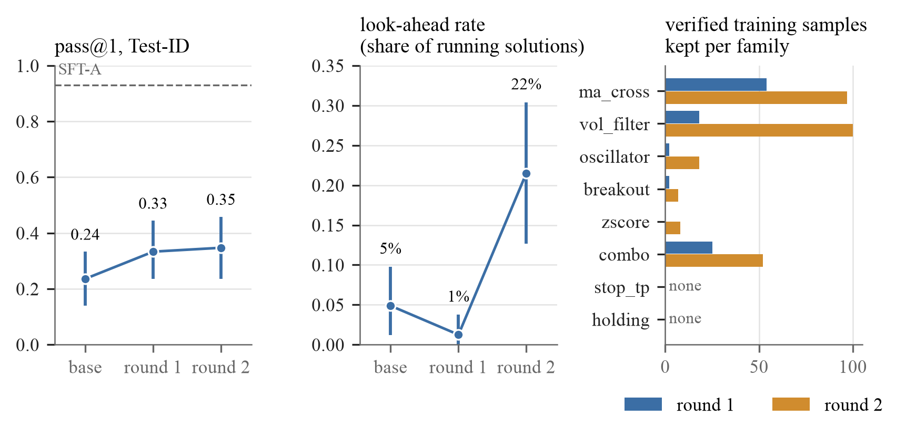

# trading-coder

A student project: how far can a small local LLM, fine-tuned on my 16 GB MacBook (Apple M2 Pro, MLX),
get at writing **correct** trading-strategy code from a plain-English specification?

**Question:** does LoRA fine-tuning a 3B code model close the gap to a 7–8B model that hasn't been
fine-tuned?

**Short answer:** fine-tuned on reference solutions, the 3B model beats the 7B overall
(0.67 vs 0.53 pass@1), but only on strategy types it was trained on (0.93). On held-out strategy types
it scores 0. Self-training on its own verified code reaches only 0.25 and taught it a look-ahead habit.

**Report:** [Trading-Coder-LoRA-Report.pdf](Trading-Coder-LoRA-Report.pdf) ·
**Lab log:** [PROGRESS.md](PROGRESS.md) (every decision, problem and fix as it happened)

Strategies are scored on correctness, not profit. A solution passes only if it runs, matches a
hand-written reference bar for bar on hidden synthetic price series, and does not look ahead:
replacing all prices after a cut point must not change any earlier position.



## Results (greedy pass@1, 95% bootstrap CI over 100 tasks)

| Condition (4-bit MLX) | pass@1 | Test-ID (72) | Test-OOD (28) | Look-ahead* |
|---|---|---|---|---|
| Qwen2.5-Coder-3B, 0-shot | 0.17 [0.10, 0.25] | 0.24 | 0.00 | 5% |
| Qwen2.5-Coder-3B, 3-shot | 0.26 [0.18, 0.35] | 0.26 | 0.25 | 0% |
| Qwen2.5-Coder-7B, 0-shot | 0.11 [0.05, 0.17] | 0.14 | 0.04 | 2% |
| Qwen2.5-Coder-7B, 3-shot | 0.53 [0.43, 0.63] | 0.60 | 0.36 | 1% |
| Llama-3.1-8B-Instruct, 0-shot | 0.10 [0.05, 0.16] | 0.14 | 0.00 | 2% |
| Llama-3.1-8B-Instruct, 3-shot | 0.40 [0.30, 0.50] | 0.56 | 0.00 | 1% |
| 3B + rejection sampling, round 1 | 0.24 [0.16, 0.33] | 0.33 | 0.00 | 1% |
| 3B + rejection sampling, round 2 | 0.25 [0.17, 0.34] | 0.35 | 0.00 | 22% |
| **3B + LoRA on reference solutions (SFT-A)** | **0.67 [0.58, 0.76]** | **0.93** | 0.00 | 0% |

\* share of running solutions that use future data.



What I found:

- **The 3B model's main weakness is logic, not format.** In 30 failures I labelled by hand, the most common
  cause is not carrying a position from one bar to the next (13), then pandas indexing/API mistakes (9).
- **Small models copy few-shot examples.** With 3 examples the 3B drops from 0.22 to 0.04 on families it
  has no example for; the 7B rises from 0.11 to 0.53.
- **Fine-tuning on reference solutions works by recall.** Validation loss falls to 0.002; on the held-out
  families the model forces each new strategy into the closest trained template (no trailing stop
  tracks its peak, 13/14 Bollinger solutions drop the band width).
- **Self-training only sharpens what the model can already do.** The stop-loss and holding families never
  produce a verified sample, so they never get training data.
- **Verified data can still teach look-ahead.** After round 2, 22% of running solutions read the last bar
  through `x[i-1]` at `i = 0`. Every training sample had passed the look-ahead check; the model learned an
  idiom that was harmless there and unsafe on new tasks.



**Compute:** 5.3 GPU-hours on the laptop in total (4,140 model completions, 1.1 h of LoRA training).
No cloud GPUs, no API calls.

## Setup

```bash
uv venv --python 3.12 .venv
uv pip install --python .venv/bin/python -r requirements.txt
.venv/bin/python -m pytest -q                            # 167 tests: harness, benchmark, extractor
.venv/bin/python -m gen.make_train --per-family 400      # training tasks -> data/
.venv/bin/python -m bench.leakage data/train_tasks.jsonl
scripts/run_baseline.sh qwen3b 0 --pause 1               # one baseline, one model per run (GPU)
.venv/bin/python -m gen.make_sft                          # SFT-A data
scripts/train_lora.sh train/lora_sft_a.yaml sft_a        # LoRA training (GPU, ~17 min)
scripts/eval_adapter.sh sft_a                            # evaluate the adapter (GPU, ~7 min)
scripts/rs_round.sh 1                                    # one rejection-sampling round (GPU, ~1.7 h)
.venv/bin/python -m report.make_figures && .venv/bin/python -m report.build_pdf   # report
```

## Layout

| Path | Contents |
|---|---|
| `harness/` | synthetic series, sandbox (AST allowlist + `sandbox-exec`), correctness and look-ahead checks |
| `bench/families/` | one module per strategy family: parameter grid, wordings, rules, pandas reference, independent loop implementation |
| `bench/tasks_test_*.jsonl` | 72 in-distribution and 28 out-of-distribution test tasks |
| `bench/leakage.py` | fails if any test prompt, parameter combination or value appears in training data |
| `gen/` | training-task generator, MLX sampling, code extraction, SFT data, rejection sampling |
| `train/` | LoRA configs (SFT-A and rejection sampling use the same settings) |
| `eval/` | scoring with bootstrap CIs, run comparison, failure samples |
| `results/` | one folder per run: config, raw generations, scores, summary, training logs |
| `report/` | figure and PDF generation |

I used Claude Code as an AI coding assistant while building this. I designed the study, made the calls
on each problem that came up, ran every model job on my machine, and checked the results.
